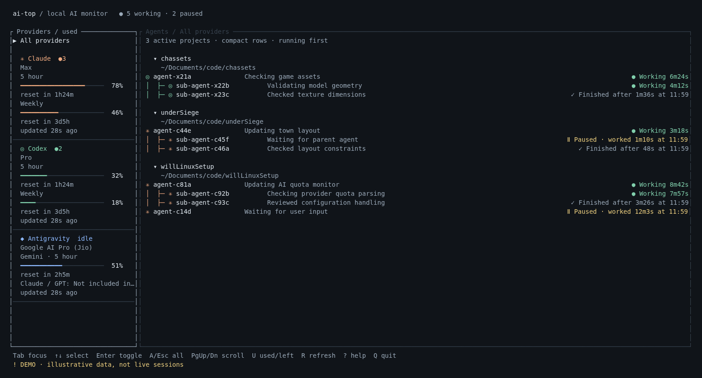
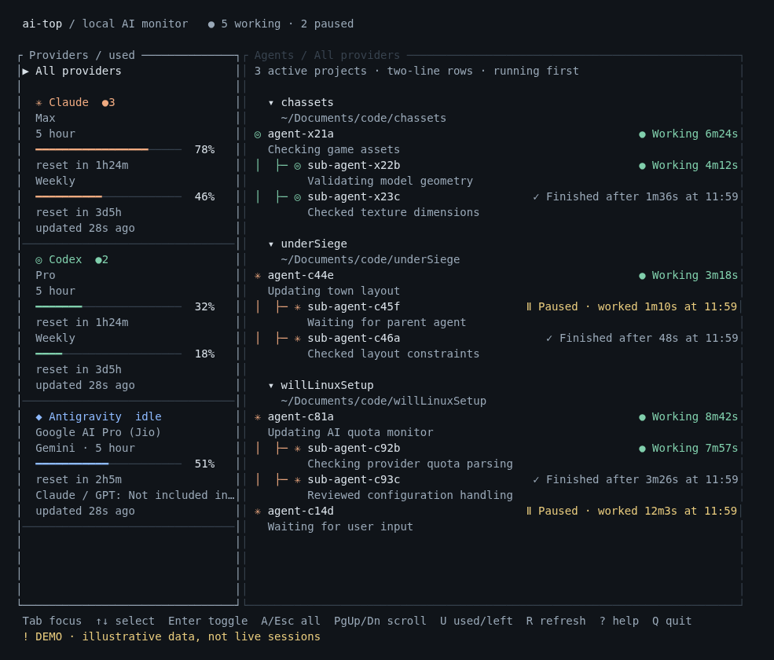

# ai-top

A Rust terminal monitor for AI quotas and local agent activity, inspired by
**btop** and **htop**. See Claude, Codex / ChatGPT, and Antigravity in one view,
with agents and sub-agents grouped by the directory they are working in.



*Actual TUI output rendered with illustrative demo data. No real account,
conversation, or prompt content appears in these screenshots.*

## Tested providers and plans

These plans have been tested successfully by the maintainer:

| Provider | Tested and working plans |
| --- | --- |
| Claude / Claude Code | **Claude Pro** |
| Codex / ChatGPT | **ChatGPT Plus** |
| Antigravity | **Free and Pro** |

Local integration checks also exercised all three quota fetchers. Automated
lifecycle and layout tests use synthetic fixtures; plan compatibility does not
mean every account tier or future provider format has been verified.

## What you get

- **Provider sidebar:** five-hour / weekly quota windows, named model pools,
  reset countdowns, plan details, credits, reset stashes, and data age where
  the provider exposes them. Toggle percentage used or remaining.
- **All providers by default:** select a provider to filter; select it again or
  press `A` / `Esc` to return to the combined view.
- **Project trees:** working directory → main agent → sub-agents, including
  attributable cross-provider CLI calls. Matching directories merge across
  providers. Running agents sort first among siblings while parents remain above
  their children.
- **Useful history:** retain paused and finished agents in projects with running
  work. Each project initially shows its five most recently finished sub-agents;
  older ones remain behind a selectable `… N more` row until explicitly expanded.
  Completed agents show their work duration and finish time. Failure,
  cancellation, unconfirmed exit, and unknown status have distinct labels.
- **Adaptive density:** one-line rows in wide terminals; name and short work
  summary on separate lines when space is narrower.
- **Independent updates:** local activity updates every two seconds; quota
  workers run separately. A slow or unavailable provider does not stall input or
  activity. Failed quota refreshes preserve the last value with its error and age.

No GTK, GNOME extension, Python, or Node.js is required by the application.
The activity collector and terminal interface are implemented in Rust.

<details>
<summary>Narrow terminal preview</summary>



</details>

## Install

Currently, local activity detection supports **Linux**. Building requires a
recent Rust toolchain supporting the 2024 edition, a C compiler, `pkg-config`,
and the SQLite 3 development library. Use a UTF-8 terminal; ordinary monospace
fonts work without Nerd Fonts or terminal image protocols.

```sh
git clone https://github.com/vquand/ai-top.git
cd ai-top
bash install.sh
ai-top
```

The installer builds the locked release and installs it to `~/.local/bin/ai-top`.
Ensure `~/.local/bin` is on your `PATH`. Alternatively:

```sh
cargo install --path . --locked
```

### Provider setup

Use your existing signed-in local tools:

| Provider | Local source |
| --- | --- |
| Claude | Claude Code credentials in `~/.claude/.credentials.json`; session registry and lifecycle logs. Respects per-process `CLAUDE_CONFIG_DIR` for activity. |
| Codex | Auth and session data in `~/.codex`, or `CODEX_HOME`. Run `codex` to refresh expired credentials. |
| Antigravity | The signed-in `agy` CLI at `~/.local/bin/agy`; local conversation-summary index and presence locks for activity. |

Quota refreshes contact the providers' usage endpoints. Antigravity runs a passive
`agy /usage` report with a timeout, browser login launches disabled, and CLI
auto-updates disabled. No model prompt is sent. Claude's OAuth refresh can rotate
its local credentials when needed. Unavailable credentials or quota pools show
an error rather than sample values.

## Controls

| Key / action | Behavior |
| --- | --- |
| `A` / `Esc` | Show all providers |
| `1` / `2` / `3` | Toggle Claude / Codex / Antigravity filter |
| Click provider | Filter; click the selected provider again to clear |
| `Tab`, `Left`, `Right` | Switch panel focus |
| `Up` / `Down`, `K` / `J` | Select provider or project |
| `Enter` / `Space` | Collapse project, expand the selected history row, or clear provider filter |
| Click project heading | Collapse / expand that tree |
| Select `… N more` + Enter, or click it | Reveal older finished sub-agents; `Show fewer` collapses them |
| `PageUp` / `PageDown`, `Home` / `End` | Scroll focused panel |
| Mouse wheel | Scroll panel under pointer |
| `U` | Toggle quota used / remaining |
| `R` | Refresh quotas |
| `?` | Help |
| `Q` / `Ctrl-C` | Quit and restore terminal |

The minimum usable terminal is 60 × 12. Rows become compact when the agent panel
has at least 105 columns; resizing adapts automatically. Particularly narrow
panels can truncate status text; widen the terminal for full timing details.

## Configuration

Optional settings live in `~/.config/ai-top/config.toml`, or the corresponding
`XDG_CONFIG_HOME` directory:

```toml
display = "used"          # "used" or "remaining"
refresh_secs = 120        # other provider polling; Claude has a 10-minute minimum
antigravity_jio = false   # true for the Jio-bundled Google AI Pro entitlement
```

For the Jio-bundled plan, `antigravity_jio = true` hides Claude/GPT pools that a
usage report may still expose despite the account lacking model access.
With no ai-top config, the existing `ai-quota-bar/config.toml` is read as a
migration fallback. `U` changes the current view without writing configuration.

## Offline preview and diagnostics

```sh
ai-top --demo                            # explicit offline sample data
ai-top --no-network                      # live local activity; no quota calls
ai-top --json                            # one local activity snapshot; no network
ai-top --once                            # one text view, including quota calls
ai-top --demo --once --width 180 --height 40
ai-top --history-hours 48                 # default 24; range 1–168
```

`--once` can wait for provider timeouts; add `--no-network` for a local-only
view. Demo data is always labeled and is never substituted for a live error.

## Privacy and detection limits

Activity is derived from Linux process ownership and local provider lifecycle
metadata. Only identifiers, directories, role / tool labels, states, and timing
are retained. The UI does not display prompts, conversation bodies, tool
arguments, or tool results. Work summaries are short metadata labels such as
`Running exec_command`, not AI-generated descriptions of private conversations.
Activity is not uploaded, and provider transcripts/databases are not modified.

Recently completed and paused sessions remain visible in projects with verified
running agents. Discovery is bounded to 500 recent Codex index rows, 200 recent
Claude main sessions per relevant project, and 500 Antigravity summaries. Files
are read incrementally; initial indexing of large histories can take multiple
polls. No separate history database is created.

Provider on-disk formats and quota APIs can change. Missing ownership or
unsupported records remain unknown rather than being reported as working.
Remote agents without local presence cannot always be attributed. Reported
finish times require lifecycle evidence; process disappearance alone does not
invent a successful completion time.

## Development

```sh
cargo test --locked
cargo clippy --locked --all-targets -- -D warnings
cargo build --release --locked
```

Add `--offline` when dependencies are cached. The tests cover lifecycle changes,
partial writes, process exits, read-only SQLite fixtures, cross-provider parent
links, retained children, quota failures, filters, scrolling, project collapse,
terminal escaping, tiny terminals, adaptive row density, and configuration
fallbacks.

The screenshot renderer uses the same Ratatui buffer as the application:

```sh
cargo run --locked --example readme_preview -- 180 40 > /tmp/ai-top-wide.html
cargo run --locked --example readme_preview -- 110 40 > /tmp/ai-top-narrow.html
```

Open the HTML files in a browser to reproduce the demo images. Application
runtime and automated tests are Rust-only.

## License

[MIT](LICENSE)

### Claude usage request pacing

AI Quota Bar and ai-top share `$XDG_CACHE_HOME/ai-quota-bar/claude-usage.json`
(default `~/.cache/ai-quota-bar/claude-usage.json`) and a process lock. Together
these tools make at most one scheduled Claude usage fetch per ten minutes;
manual refresh and restarts respect the same cache. Other providers retain their
configured refresh interval. The cache contains quota data and errors, never tokens.

Anthropic does not publish a polling limit for the OAuth `/api/oauth/usage`
endpoint. Ten minutes is a conservative fallback, twice the five-minute Claude
Code cadence [reported in its tracker](https://github.com/anthropics/claude-code/issues/93107),
not a verified server limit. On HTTP 429, requests pause for at least 20 minutes,
then 40 and 60 minutes for repeated failures. A valid `Retry-After` extends that
pause to at least twice the requested delay. A successful request resets backoff.
Other clients, including Claude Code sessions, can still consume the account's
shared endpoint allowance. The public Admin Usage and Cost API's once-per-minute
polling guidance applies to a different endpoint.
